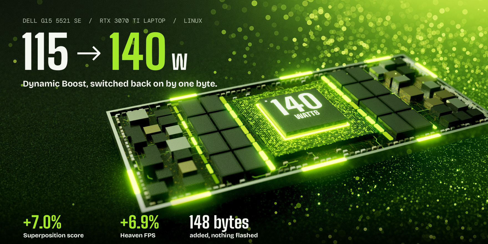
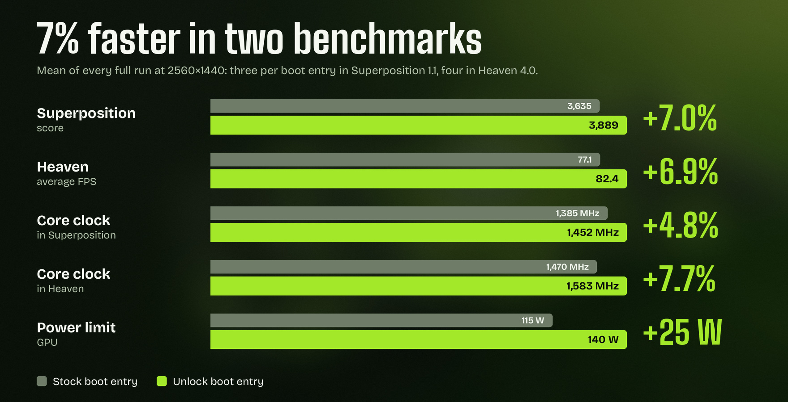
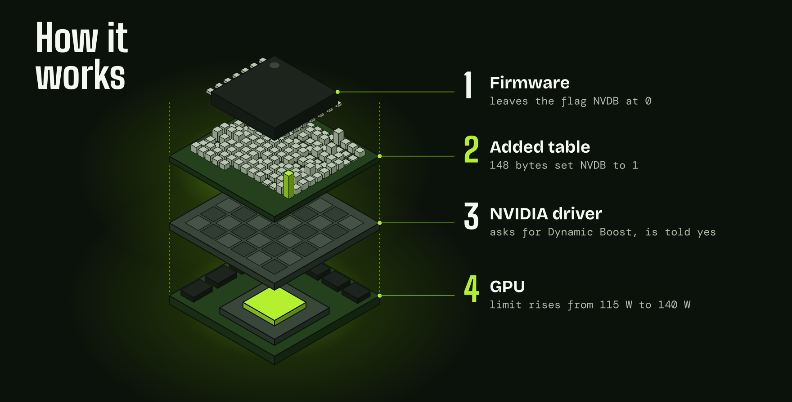

<p align="center"></p>

# Dell G15 Dynamic Boost

Brings back NVIDIA Dynamic Boost on Linux for a Dell G15 whose BIOS hides it. The GPU limit goes from **115 W to 140 W** through a separate boot entry. Nothing is flashed, and the normal boot entry is left alone.

> [!WARNING]
> Tested on **one** laptop. It raises GPU power and heat to the maximum Dell's own tables allow, and it works around a setting the BIOS left off. Use it at your own risk, plugged in, with a rescue USB stick at hand.

## Results



| | Stock | Unlock | Change |
|---|---:|---:|---:|
| Superposition 1.1 score | 3,635 | 3,889 | **+7.0%** |
| Superposition 1.1 average FPS | 27.2 | 29.1 | **+7.0%** |
| Heaven 4.0 average FPS | 77.1 | 82.4 | **+6.9%** |
| Core clock, Superposition | 1,385 MHz | 1,452 MHz | +4.8% |
| Core clock, Heaven | 1,470 MHz | 1,583 MHz | +7.7% |
| GPU power limit | 115 W | 140 W | +25 W |

### What it costs

| | Stock | Unlock | Change |
|---|---:|---:|---:|
| Power draw, Superposition | 113.5 W | 137.2 W | +20.8% |
| Power draw, Heaven | 114.5 W | 139.1 W | +21.5% |
| Peak GPU temperature, Superposition | 67 °C | 74 °C | +7.4 °C |
| Peak GPU temperature, Heaven | 69 °C | 78 °C | +8.5 °C |
| Score per watt, Superposition | 32.0 | 28.3 | −11.5% |
| FPS per watt, Heaven | 0.673 | 0.593 | −12.0% |
| Lowest FPS, Superposition | 22.6 | 22.8 | no real change |

### How it was measured

Same laptop, kernel, driver and Performance profile; only the boot entry differs. Both benchmarks ran in fullscreen at 2560×1440 with OpenGL: Superposition with Extreme shaders, Heaven with Ultra quality, Extreme tessellation and 8× anti-aliasing. The GPU was cooled to 45 °C or below before each run.

The numbers are means of every full-length run: three per boot entry in Superposition and four in Heaven. Runs within one set differ by 0.7% or less. In Superposition one more run per set ended early and is left out. Lowest FPS leaves out the first run of each set. In Heaven, one earlier unlock run was stopped by the test script and is not counted.

Both benchmarks were limited by power about 100% of the time, so this is close to a best case: games limited by the CPU or a frame cap gain little or nothing. Both boot entries used the same undervolt curve (172 MHz lower from 881 mV up). Raw numbers: [`superposition.jsonl`](data/superposition.jsonl), [`heaven.jsonl`](data/heaven.jsonl).

## How it works



`nvidia-powerd` fails on this laptop with `SBIOS support not found for NVPCF GET_SUPPORTED`. The cause is one byte. Dell's firmware contains a complete power budget, but the method that announces it returns the flag `NVDB`, and the BIOS leaves that at 0.

[`src/npcf-on.asl`](src/npcf-on.asl) compiles to a 148-byte table that sets `NVDB` to 1 in memory. It does so only if the firmware's header and tail markers are in place and the GPU is of the expected generation. The kernel loads it from a small extra `initrd` file, before the NVIDIA driver asks.

- **No table is replaced.** Dell's NVIDIA table contains hardcoded memory addresses, so a frozen copy could point at the wrong place after a BIOS change. Adding a table avoids that.
- **It has to happen at boot.** Setting the flag later works in ACPI, but the driver keeps its first answer.

## Tested on

| | |
|---|---|
| Laptop | Dell G15 Special Edition 5521, BIOS 1.44.0 |
| GPU | GeForce RTX 3070 Ti Laptop, `10de:24e0` |
| System | Nobara 44, kernel 7.3.4, NVIDIA open modules 620.70.06, Secure Boot off |

Suspend was tested three times, the longest 75 seconds on the charger. Long sleep on battery, hibernation and other models were **not** tested.

## Known issues

- `nvidia-powerd` logs `JPAC` and `SysPwrLimitGetInfo` errors. They seem to concern boost on battery; boost on the charger works.
- Twice, after about eight minutes of heavy load on the charger, the battery gauge jumped from 100% to 94%. In the four Heaven runs that followed, the battery gained charge while the GPU drew 139 W, so it looks like the gauge correcting itself. The cause is not proven.
- Remove the unlock before any BIOS update, BIOS setting change or RAM change.
- The boot entry is tied to one kernel version.
- Once, with LACT set to Prefer Maximum Performance, the GPU stayed at its idle clock under load after a suspend. It recovered when set back to Adaptive. The cause is not proven.

## Install

Works with GRUB and BLS boot entries, as on Fedora and Nobara. Read [`install.sh`](install.sh) first; it is short.

```sh
git clone https://github.com/BiparJoy/dell-g15-dynamic-boost
cd dell-g15-dynamic-boost
sudo ./install.sh --dry-run   # runs every check, writes nothing
sudo ./install.sh
```

Restart, choose **GPU boost UNLOCK** in GRUB and run `./check.sh`. Set the Performance profile for the full 140 W; Balanced gives 130 W. Your normal entry stays the default.

The installer adds exactly two files: `/boot/npcf-boost.cpio` and one boot entry. It **refuses** to run on any other laptop model or GPU, when Dynamic Boost already works, when Dell's tables lack the expected flag and markers, with Secure Boot or kernel lockdown on, or without a BLS entry for the running kernel.

It is covered by [tests](tests/run.sh) on a fake system and by a dry run on the real laptop. The entry used for the benchmarks was made by an earlier script with the same two steps.

### Undo

```sh
sudo ./uninstall.sh
```

After a kernel update, uninstall and install again.

### If it does not boot

1. Hold the power button for 10 seconds, then choose your normal entry. It never loads the table.
2. If GRUB boots nothing, start a live USB, mount your `/boot` partition and delete `npcf-boost.cpio` and `loader/entries/*-npcf-boost.conf`.

*Not affiliated with NVIDIA or Dell. In the diagram, the highlighted byte is drawn taller than its value.*

## Credits

[loq-npcf](https://github.com/Punch-Pain/loq-npcf) showed on a Lenovo LOQ that an ACPI change can restore Dynamic Boost, and the [Dell community thread](https://www.dell.com/community/en/conversations/linux-general/g15-5520-and-other-laptops-missing-acpi-support-for-advanced-optimus-on-linux-nvpcf-not-exposed/67f8ea6c0141bf65d7cc7fbb) documented the fault on the G15.

## Licence

[MIT](LICENSE). No warranty.
